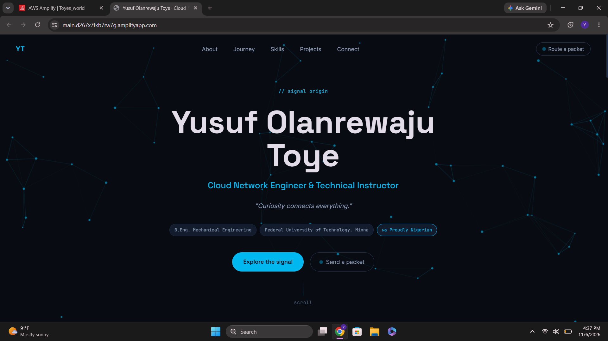
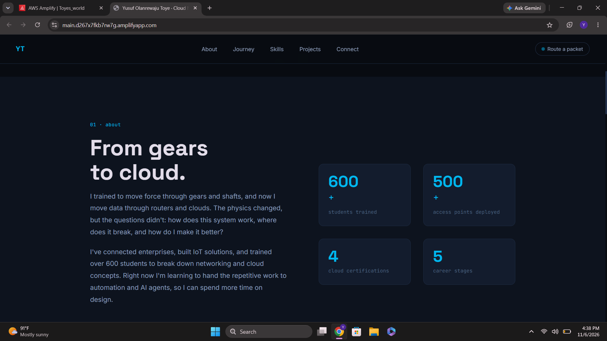
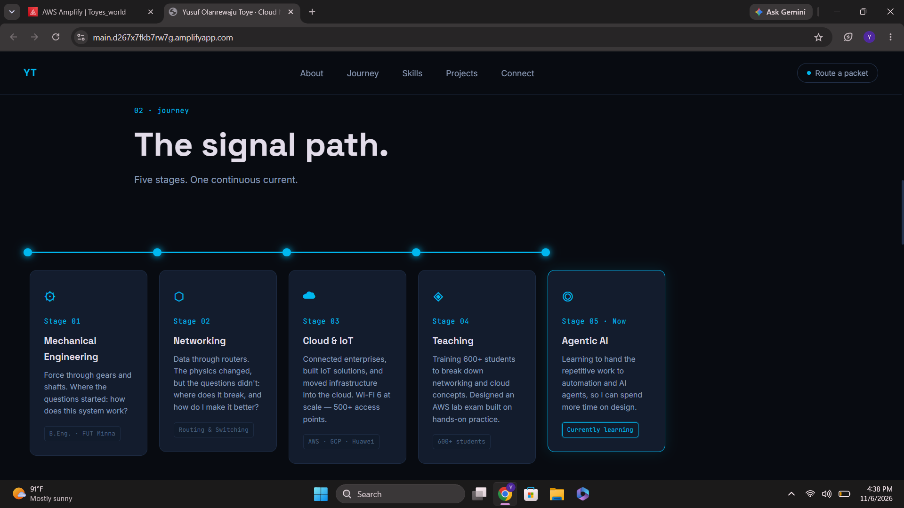
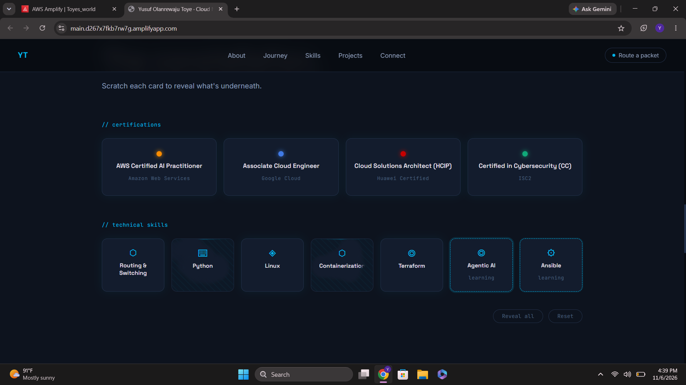
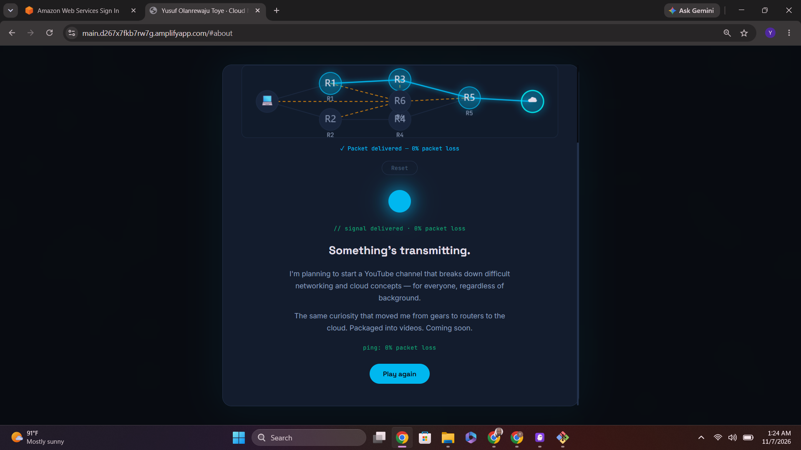
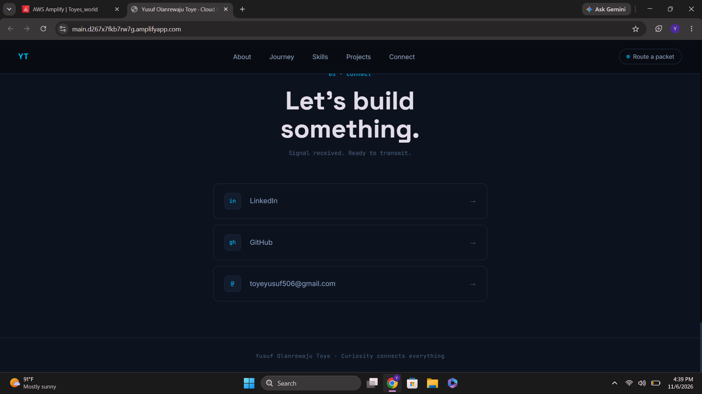
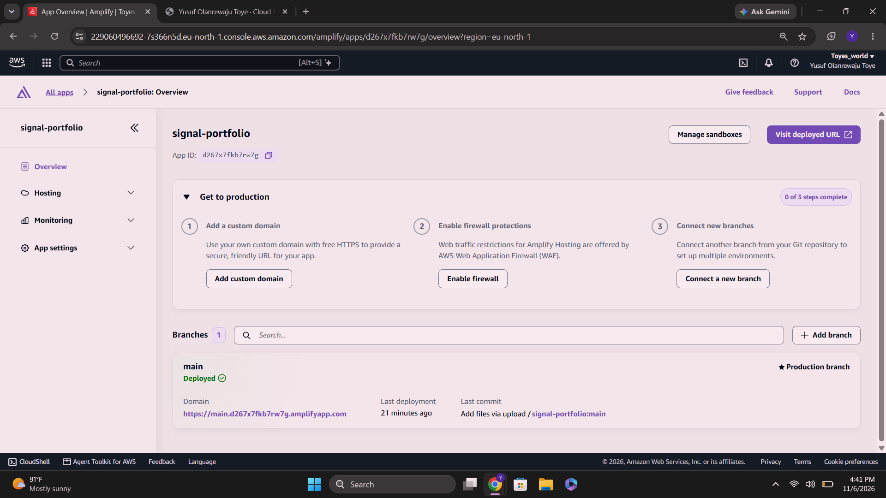

# Signal Portfolio — Yusuf Olanrewaju Toye

> *"Curiosity connects everything."*

A personal portfolio website built for the **AWS Student Builder Challenge: Build Your Tech Superpower**. Designed from scratch with plain HTML, CSS, and JavaScript — no frameworks, no build tools, no dependencies — and deployed globally on **AWS Amplify Hosting**.

🔗 **Live site:** https://main.d267x7fkb7rw7g.amplifyapp.com  
🐙 **Repository:** https://github.com/toyeyusuf/signal-portfolio

---

## Screenshots

### Hero — live animated network topology


### About — animated counters


### Journey — circuit trace timeline


### Skills — interactive scratch cards


### Packet routing game — creative feature


### Connect


### AWS Amplify — deployed and live


---

## The concept

Most portfolios are CVs dressed in CSS. This one is different.

The design concept is **"The Signal"** — every section of the site is a layer a signal travels through. The visual language is consistent from top to bottom: deep navy dark mode, cyan `#00c8ff` as the signal color, Space Grotesk headlines, and JetBrains Mono for code-style labels.

The goal was to make a visitor *feel* the journey from mechanical engineering to cloud networking — not just read about it. Each section uses a different interactive metaphor drawn directly from the domain:

| Section | Metaphor |
|---|---|
| Hero | Live animated network topology (Canvas API particles) |
| Journey | Circuit trace that lights up stage by stage as you scroll |
| Skills | Scratch cards — drag to uncover each skill |
| Projects | Minimal vending machine — insert a coin to unlock each project |
| Transmitting | Locked fun fact — only revealed after successfully routing a packet |
| Connect | Signal endpoints |

---

## How I built it

### Starting point — a plan, not a template

Before writing a single line of code, I wrote a detailed `plan.md` file describing exactly who I am, what sections I wanted, the visual style I was going for, and the interactive features I had in mind. This became the single source of truth for the entire build — nothing in the site was invented or assumed. Every detail came from that document.

The style brief was deliberate: *"I don't want a conventional portfolio template. Think of a premium digital experience with the visual quality of a modern technology studio."* That constraint shaped every decision that followed.

### Building with Kiro IDE

I used **Kiro IDE** as my agentic AI development environment. Rather than generating a generic template, I worked with the agent conversationally — describing what I wanted, reviewing what it produced, and pushing it further with each iteration.

The process for each feature was:
1. Describe the idea and the constraints (plain HTML/CSS/JS only, no frameworks)
2. Review the output against the plan
3. Ask for refinements — the scratch cards went through two designs before landing on the canvas-based erase mechanic; the projects section started as a card grid, then became a vending machine after I pushed for something more original
4. Verify it worked in the browser before moving on

The creative feature — the packet routing game — came directly from my networking background. I wanted something that only a network engineer would think to build as an easter egg. The game locks the fun fact section until a visitor successfully routes a packet from a laptop through the topology to the cloud. That connection between the interaction and the reveal is what makes it meaningful rather than just decorative.

### Technology choices

The constraint of plain HTML, CSS, and JavaScript was intentional. No frameworks, no build step, no `node_modules`. Every animation, interaction, and visual effect had to be built from first principles:

| Technology | How it is used |
|---|---|
| HTML5 Canvas | Hero particle network, scratch card erase mechanic, packet routing game |
| CSS custom properties | Design tokens — one change propagates across the entire site |
| `IntersectionObserver` | Scroll-triggered animations without a library |
| `globalCompositeOperation` | The core of the scratch card mechanic (`destination-out`) |
| Web Audio API | Procedurally generated sounds in the vending machine — no audio files |
| CSS Grid + Flexbox | All layout, including the responsive vending machine |
| Google Fonts | Inter, Space Grotesk, JetBrains Mono |
| GitHub | Source code repository and version history |
| AWS Amplify Hosting | Global deployment, CDN, automatic HTTPS |

### Deployment on AWS Amplify

After the site was built and tested locally, I pushed the three files to GitHub and connected the repository to **AWS Amplify Hosting**.

Since the site has no build step, the Amplify configuration is intentionally minimal:

```yaml
version: 1
frontend:
  phases:
    build:
      commands: []
  artifacts:
    baseDirectory: /
    files:
      - '**/*'
  cache:
    paths: []
```

Amplify detects `index.html` at the repository root and serves the files directly through its global CDN with automatic HTTPS. Every push to the `main` branch triggers an automatic redeploy — no manual steps needed after the initial setup.

The full workflow in five steps:

1. Write the plan — describe the portfolio, the style, and every interactive feature in detail
2. Build with Kiro — work with the agent to produce the HTML, CSS, and JavaScript
3. Test locally — open `index.html` directly in the browser
4. Push to GitHub — commit the three source files and the README
5. Deploy on Amplify — connect the repository once; Amplify handles everything after that

---

## Creative feature — Send a Packet

The signature interactive feature is a **network packet routing game**, accessible from the navbar, the hero section, and the Transmitting section.

### How it works

A network topology is drawn on an HTML5 Canvas: a laptop, six router nodes (R1–R6), and a cloud endpoint. Some links are live (solid cyan), some are down (dashed amber). The visitor clicks nodes in order to build a valid route — exactly the way a network engineer traces a path through a real topology.

```
Laptop ──── R1 ──── R3 ──┐
       └─── R2 ──── R4 ──┴── R5 ──── Cloud
```

Links through R6 are down. Two valid routes exist:
- `Laptop → R1 → R3 → R5 → Cloud`
- `Laptop → R2 → R4 → R5 → Cloud`

### The reveal

The game is the gatekeeper for the fun fact section. The Transmitting section shows a locked panel — no content visible — until a successful route is completed. On success:

1. The packet animates along the chosen path in real time
2. The overlay confirms delivery: *"Packet delivered."*
3. Simultaneously, the fun fact section on the page unlocks — locked panel fades out, content fades in
4. The visitor clicks "See what's there →" and the page scrolls to the revealed section

The fun fact: I'm planning a YouTube channel that breaks down networking and cloud concepts for everyone — the same curiosity that moved me from mechanical engineering to cloud, packaged into videos.

The game supports mouse, touch, and full keyboard navigation (arrow keys + Enter).

---

## Features

- **Hero** — Animated Canvas particle network, typewriter name reveal, scroll hint
- **About** — Counters that animate up when scrolled into view (600+ students, 500+ access points)
- **Journey** — Horizontal circuit trace timeline, 5 career stages lighting up in sequence on scroll
- **Skills** — 11 scratch cards (4 certifications + 5 tech skills + 2 currently-learning). Erase the cover with your mouse or finger to reveal each one
- **Projects** — Vending machine: drag a coin to the slot, select a slot, watch the project card drop into the tray
- **Transmitting** — Locked fun fact section, unlocked only by completing the packet routing game
- **Connect** — LinkedIn, GitHub, and email

---

## What I learned

The constraint of no frameworks was the best creative decision. It forced me to genuinely understand every mechanism I was building rather than wrapping a library around it.

**Specific things I learned or deepened:**

- **Canvas compositing** — `destination-out` for the scratch card erase mechanic was new to me. Understanding alpha channels at the pixel level made the whole thing click.
- **Web Audio API** — generating sounds with oscillators and gain envelopes is far more expressive than I expected for something that produces no audio files.
- **`IntersectionObserver` sequencing** — driving the circuit trace animation across multiple elements in a timed sequence, not just fading things in individually.
- **Drag-and-drop without libraries** — handling pointer events across document boundaries, scaling canvas coordinates for touch, and making it feel natural took the most iteration of anything in the project.
- **AWS Amplify Hosting** — the GitHub integration was the most immediately useful thing I learned. Push code, Amplify redeploys. That feedback loop made iterating on the live site fast and low-friction.

---

## Challenges

**Connecting the game to the fun fact section.** The first version revealed the fun fact inside the game overlay. It felt disconnected from the rest of the site. The better solution was to make the section itself the payoff — the overlay is the puzzle, the section is the reward. That required the game to reach out and modify a completely separate section of the DOM cleanly, without a framework, using carefully sequenced CSS transitions.

**Canvas sizing across devices.** Both the scratch cards and the packet game use canvases sized to their containers. Getting correct sizing across device pixel ratios, scroll-during-resize edge cases, and touch coordinate scaling required more precision than expected.

**Accessibility for drag interactions.** The vending machine coin is draggable — inherently inaccessible by default. Adding keyboard alternatives (press Enter to insert the coin, Enter to select a slot) meant the entire interaction works without a pointer device.

**Git and version control.** Pushing to GitHub from a new Windows machine involved resolving branch name mismatches (`master` vs `main`) and credential setup. Worth knowing early next time.

---

## Project structure

```
signal-portfolio/
├── index.html          # All markup, templates, overlays
├── styles.css          # Design tokens, layout, animations
├── script.js           # All interactive logic
├── README.md           # This file
└── screenshots/        # Screenshots for this README
    ├── hero.png
    ├── about.png
    ├── journey.png
    ├── skills.png
    ├── packet-game.png
    ├── connect.png
    └── amplify.png
```

No `node_modules`. No `package.json`. No build output. Three source files. Open `index.html` in any browser to run it locally.

---

## Run locally

```bash
git clone https://github.com/toyeyusuf/signal-portfolio.git
cd signal-portfolio
```

Open `index.html` in any browser. No server or installation needed. Optionally:

```bash
python -m http.server 8000
```

Then visit `http://localhost:8000`. Note: Google Fonts load from the internet, so fonts fall back to system fonts when offline.

---

## Featured projects in the portfolio

- **Web Server on Google Cloud** — Terraform project provisioning a custom VPC, firewall rules, and a Compute Engine instance. [GitHub →](https://github.com/toyeyusuf/hug-terraform-challenge-week1)
- **Reusable Terraform Modules** — Refactored Google Cloud infrastructure into reusable modules with remote state management. [GitHub →](https://github.com/toyeyusuf/hug-terraform-challenge-week2)
- **Wi-Fi 6 at Huawei Technologies Nigeria** — Field engineering across 500+ access points using Huawei iMaster NCE-Campus.
- **Teaching Networking & Cloud** — Trained 600+ students, designed an AWS lab exam built on hands-on practice.

---

## About me

**Yusuf Olanrewaju Toye**  
Cloud Network Engineer & Technical Instructor  
B.Eng. Mechanical Engineering — Federal University of Technology, Minna 🇳🇬

I trained to move force through gears and shafts, and now I move data through routers and clouds. The physics changed, but the questions didn't: how does this system work, where does it break, and how do I make it better?

**Certifications:** AWS Certified AI Practitioner · Google Cloud Associate Cloud Engineer · Huawei HCIP Cloud Solutions Architect · ISC2 Certified in Cybersecurity  
**Technical skills:** Routing & Switching · Python · Linux · Containerization · Terraform  
**Currently learning:** Agentic AI · Ansible

📎 [LinkedIn](https://linkedin.com/in/yusuflarrytoye) · [GitHub](https://github.com/toyeyusuf) · toyeyusuf506@gmail.com

---

*Built for the AWS Student Builder Challenge · October–November 2026*
